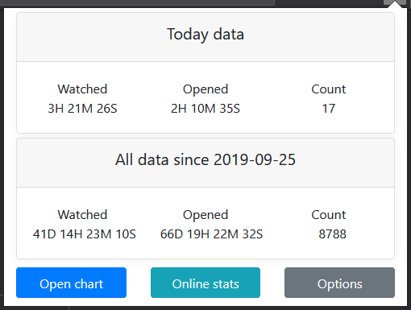
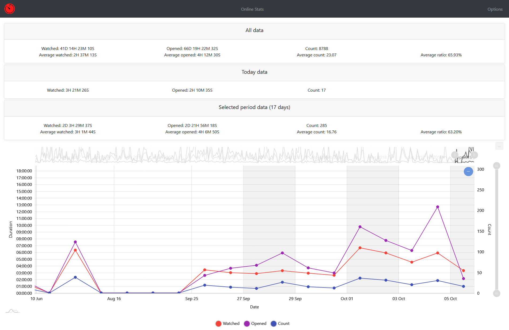

# YTTracker
An extension to track time on YouTube

[
](https://chrome.google.com/webstore/detail/youtube-tracker/knnlnielflnfhdohmihofhdelgahgjdb)

[
](https://addons.mozilla.org/en-US/firefox/addon/youtube-tracker/)

## Description
This application will track your time spent on YouTube. This data can be viewed rapidly in the popup icon or in a chart.

The data tracked is:
* Two kind of time are recorded:
  * The total time of opened videos. This time is counted when the video page have been loaded.
  * The total time of playing videos. This time is counted when a video is playing.
* The number of videos opened.

The count and time of videos opened are counted only one time per each hour maximum. This is to avoid having unintended reloads of the page bringing up the statistics.

You can also choose to send those data to a server to be able to compare yourself with others. The stats are available [here](https://yttracker.rakambda.fr/).

## Screenshots
<div align="center">
    <p>Popup window:</p>
    
    <hr style="width:85%"/>
    <p>Chart view:</p>
    
    <hr style="width:85%"/>
</div>

## Development
Built with [WXT](https://wxt.dev) and TypeScript. See [AGENTS.md](AGENTS.md) for how the code works.

```
pnpm install
pnpm dev            # Chrome with hot reload (pnpm dev:firefox for Firefox)
pnpm check          # type check, lint and tests
pnpm zip            # store zip in .output/ (pnpm zip:firefox, pnpm zip:beta)
```

## Libraries
Chart.js - [https://www.chartjs.org](https://www.chartjs.org)

## Help
If you have any problems with the extension, you can describe the issue [here](https://github.com/RakambdaOrg/YTTracker/issues).

## Technical notes

### Publishing to the Chrome Web Store

`pnpm release:chrome` runs the checks, builds the zip and uploads it with the Chrome Web Store API v2, which authenticates with a Google Cloud service account. The older OAuth client ID, client secret and refresh token are only accepted by the deprecated v1.1 API. One-time setup:

1. In the [Google Cloud console](https://console.cloud.google.com/), create or pick a project, then search for **Chrome Web Store API** and enable it.
2. Under **IAM & Admin > Service accounts**, create a service account. It needs no roles. Open it, go to **Keys > Add key > Create new key > JSON**, and keep the downloaded file safe.
3. In the [Chrome Web Store Developer Dashboard](https://chrome.google.com/webstore/devconsole/), open **Account**, and add the service account's email address. A publisher can have only one service account.
4. Still in the dashboard, copy your publisher ID from **Publisher > Settings**.
5. Give the credentials to the upload, either as environment variables or in a `.env.submit` file at the repository root (git-ignored):

   ```
   CHROME_PUBLISHER_ID=<publisher ID>
   CHROME_SERVICE_ACCOUNT_CLIENT_EMAIL=<"client_email" from the JSON key>
   CHROME_SERVICE_ACCOUNT_PRIVATE_KEY="<"private_key" from the JSON key, with its \n line breaks>"
   ```

`pnpm zip:beta` builds the beta listing's zip, which is uploaded by hand.

### Publishing to Firefox

`pnpm zip:firefox` builds the extension zip and the sources zip that addons.mozilla.org asks for. Upload both by hand, with `Mozilla-libs.txt` as the note to reviewers. The manifest declares online sharing as optional data collection (`websiteActivity`). On Firefox 140 and newer, turning on sharing in the options page shows Firefox's own consent prompt.

### Dropbox

Dropbox export and import use the OAuth authorization code flow with PKCE and offline access. The user logs in once, and the extension refreshes its token by itself. No app secret is needed or stored. To set up the Dropbox app, in the [Dropbox App Console](https://www.dropbox.com/developers/apps):

1. Create an app (or open the existing one) with **Scoped access** and **App folder** access. Exports are written to and read from the root of that folder.
2. On the **Permissions** tab, enable `files.metadata.read` (to list the exports), `files.content.read` and `files.content.write`, then click **Submit**. A user who logged in before a permission was added must log in again to get it.
3. On the **Settings** tab:
   - Copy the **App key** into `CLIENT_ID` in `src/lib/dropbox.ts`.
   - Set **Allow public clients (Implicit Grant & PKCE)** to **Allow**.
   - Under **OAuth 2 > Redirect URIs**, add one URI per extension. Each URI is what `browser.identity.getRedirectURL()` returns, and it must match exactly, including the trailing `/`:
     - Chrome: `https://knnlnielflnfhdohmihofhdelgahgjdb.chromiumapp.org/`
     - Chrome beta: `https://moboafdnejnjnppicfiadaalobjeemec.chromiumapp.org/`
     - Firefox: `https://<hash>.extensions.allizom.org/`. The hash comes from the add-on ID. To get it, load the extension, open its console from `about:debugging`, and run `browser.identity.getRedirectURL()`.
4. An app in **Development** status accepts at most 500 users. Above that, use **Apply for production** on the Settings tab.

The Chrome IDs come from the `key` values in `wxt.config.ts`, so unpacked builds get the same IDs as the store versions.
